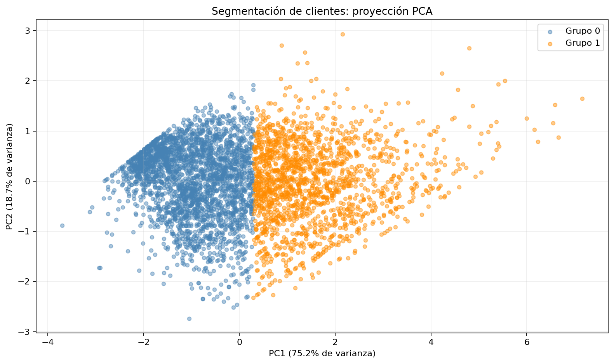
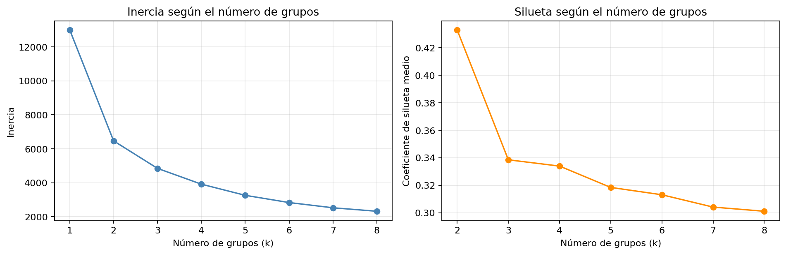
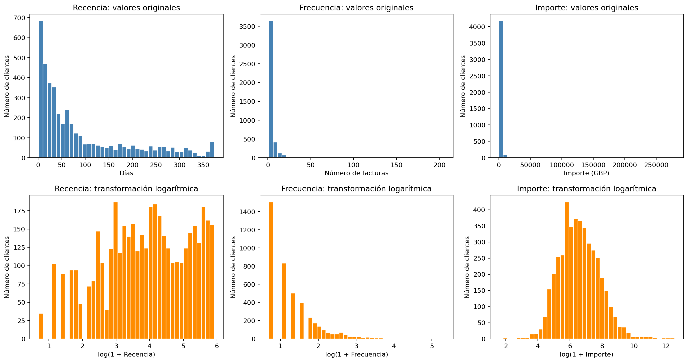

# Segmentación de clientes con K-means

Segmentación exploratoria de **4.334 clientes** de una tienda online británica mediante variables RFM, transformación logarítmica y K-means. El proyecto compara el número de grupos, describe sus perfiles y evalúa la estabilidad frente a distintas inicializaciones.

**Autor:** Matías Almonacid Mellado

[Ver el notebook ejecutado](customer_segmentation.ipynb)

## Resultado principal

Se seleccionan **dos grupos**, con una silueta de **0,433**, la mayor entre las alternativas evaluadas de k = 2 a k = 8.

| Indicador | Grupo 0 | Grupo 1 |
| --- | ---: | ---: |
| Clientes | 2.673 | 1.661 |
| Participación de clientes | 61,68 % | 38,32 % |
| Recencia mediana | 97 días | 17 días |
| Frecuencia mediana | 1 factura | 6 facturas |
| Importe mediano | £358,38 | £2.044,87 |
| Participación en ventas positivas | 15,12 % | 84,88 % |

El grupo 1 presenta, en sus medianas, compras más recientes, mayor frecuencia y mayor importe acumulado. Estas características describen tendencias del grupo; no son condiciones que cumplan todos sus integrantes.



La proyección conserva el **93,85 % de la varianza** de las variables transformadas y estandarizadas. La nube presenta continuidad entre los segmentos: la frontera de colores es una partición del algoritmo, no evidencia de dos categorías naturales aisladas. El porcentaje explicado por PCA no mide precisión predictiva.

## Metodología

1. Selección de ventas positivas de productos con cliente identificado.
2. Construcción de recencia, frecuencia e importe por cliente.
3. Inspección de distribuciones y transformación `log1p`.
4. Estandarización con `StandardScaler`.
5. Comparación de inercia, silueta y tamaños de grupos para distintos valores de k.
6. Comparación de perfiles para k = 2 y k = 3.
7. Evaluación de estabilidad mediante el índice de Rand ajustado (ARI).
8. PCA de dos componentes para visualizar la partición calculada en tres dimensiones.

Cada ajuste de K-means utiliza 20 inicializaciones. El modelo de referencia emplea la semilla 42. La silueta se calcula sobre todos los clientes.



Las diez semillas adicionales producen un ARI mínimo de **0,9981** y un promedio de **0,9994** frente al modelo de referencia. Esta comprobación evalúa la sensibilidad a la inicialización sobre los mismos datos, no la estabilidad temporal.

## Variables y alcance

- **Recencia:** días calendario desde la última compra hasta el 10 de diciembre de 2011.
- **Frecuencia:** número de facturas de venta distintas en el período.
- **Importe:** suma de las líneas positivas seleccionadas, en GBP.

La selección incluye 396.340 líneas y 18.402 facturas. Se excluyen cancelaciones y códigos identificados como envíos, comisiones, descuentos, ajustes, operaciones manuales, muestras y vales. Se mantienen las filas exactamente repetidas porque no existe un identificador de línea que permita confirmar errores.



## Datos

Chen, D. (2015). *Online Retail*. UCI Machine Learning Repository. [DOI: 10.24432/C5BW33](https://doi.org/10.24432/C5BW33).

El archivo original contiene 541.909 registros entre el 1 de diciembre de 2010 y el 9 de diciembre de 2011. Disponible en [UCI](https://archive.ics.uci.edu/dataset/352/online+retail), bajo [CC BY 4.0](https://creativecommons.org/licenses/by/4.0/).

El Excel se descarga por separado y no se incluye en este repositorio.

## Cómo ejecutar

1. Descarga este repositorio y extrae su contenido.
2. Descarga los datos de UCI, descomprime el archivo y coloca `Online Retail.xlsx` junto al notebook.
3. Instala las dependencias en una terminal dentro de la carpeta del proyecto:

   ```bash
   python -m pip install -r requirements.txt
   ```

4. Inicia Jupyter:

   ```bash
   python -m jupyterlab
   ```

5. Abre `customer_segmentation.ipynb` y ejecuta las celdas en orden desde un kernel reiniciado.

Los gráficos se guardan en `figures/` y las tablas en `resultados/`. La importación del Excel y el cálculo de siluetas pueden tardar un poco. El proyecto es independiente y no requiere otros notebooks.

## Archivos

| Archivo o carpeta | Contenido |
| --- | --- |
| `customer_segmentation.ipynb` | Código, resultados e interpretaciones |
| `figures/` | Distribuciones RFM, evaluación de k y proyección PCA |
| `resultados/clientes_segmentados.csv` | Variables RFM originales y grupo de cada cliente |
| `resultados/evaluacion_k.csv` | Inercia, silueta y tamaños de grupos |
| `resultados/perfiles_k2.csv`, `perfiles_k3.csv` | Resúmenes por grupo |
| `resultados/estabilidad_semillas.csv` | Inercia y ARI para las semillas alternativas |
| `resultados/proyeccion_pca.csv` | Coordenadas PCA y grupos |
| `resultados/varianza_pca.csv`, `coeficientes_pca.csv` | Varianza explicada y coeficientes |
| `requirements.txt` | Dependencias para reproducir el análisis |

## Limitaciones

Los importes son ventas positivas antes de posibles cancelaciones posteriores. No representan gasto neto, rentabilidad ni valor futuro del cliente. Una compra cancelada puede seguir influyendo en las variables RFM.

Se excluyen clientes no identificados. Los clientes observados tienen diferentes tiempos de seguimiento y diciembre de 2011 está incompleto.

Los resultados dependen de los filtros, transformaciones, escalado y variables elegidas. Las correlaciones entre frecuencia e importe también influyen en las distancias. No se ha probado sensibilidad a deduplicación, cancelaciones o períodos alternativos.

Las etiquetas numéricas son arbitrarias y pueden intercambiarse entre ejecuciones o entornos. La estabilidad frente a semillas no demuestra utilidad comercial ni permanencia de los segmentos. El análisis es exploratorio y no incluye validación predictiva sobre clientes futuros.

## Verificación

Las celdas se ejecutaron secuencialmente en un proceso Python limpio, sin utilizar un kernel de Jupyter. Se comprobaron los conteos de líneas, facturas y clientes, la conservación del importe, los valores finitos, la elección de k por silueta, la estabilidad y la varianza explicada por PCA.

Las versiones comprobadas se registran en `requirements.txt`. Pequeñas diferencias numéricas pueden aparecer entre entornos y versiones.
